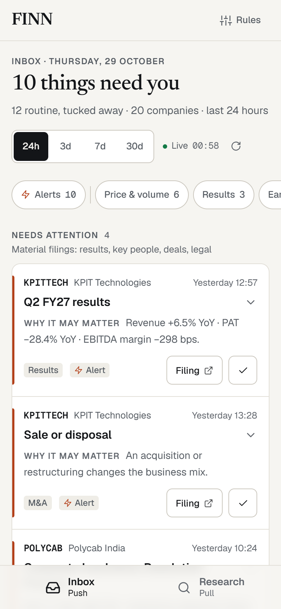
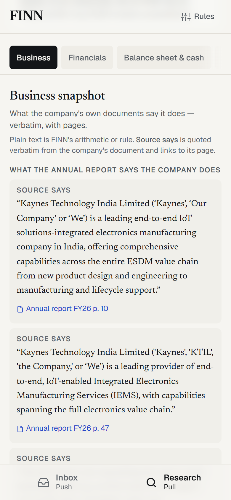
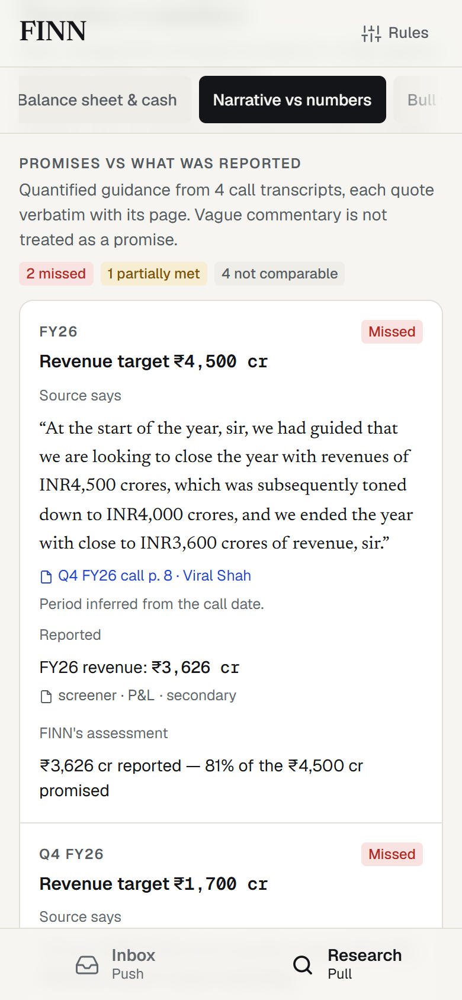

# FINN — Investor Signal Inbox

A mobile-first prototype for the ENAM AI Engineer Build Challenge. For a portfolio of NSE-listed companies, FINN answers three questions through the day:

**What changed? Why should I care? Which filing proves it?**

- **Push — the inbox.** Every exchange filing and end-of-day price or volume move across the portfolio, triaged into *Needs attention*, *Price & volume alerts* (compact rows), *Worth a look* and a collapsed *Routine* pile. Results arrive with Revenue / EBITDA / PBT / PAT already compared QoQ and YoY. An incoming CFO arrives with the background the company itself disclosed. Each card links to the filing it rests on.
- **Pull — research.** Type any NSE ticker. FINN finds the company's own documents — the latest annual report, the last four earnings-call transcripts, the latest results filing and investor presentation — reads them page by page, and answers in five views: **business snapshot**, **financial trajectory**, **balance sheet & cash quality**, **narrative vs numbers** (what management promised against what it reported) and **bull vs bear**. Every claim links to the page of the primary document it rests on, or says plainly that its citation is document-level. What the source says and what FINN makes of it are never mixed.

| Inbox (push) | Business snapshot (pull) | Narrative vs numbers (pull) |
|---|---|---|
|  |  |  |

- **Try it:** https://finn-seven-rho.vercel.app on a phone. It opens on the committed demo capture; *Switch to live data* in the banner moves to live data.
- **Evaluating it?** [EVALUATOR_RUNBOOK.md](EVALUATOR_RUNBOOK.md) is a three-minute walkthrough.
- **Where the data comes from:** [DATA_SOURCES.md](DATA_SOURCES.md).
- **Why the screens work the way they do:** [PRODUCT_DECISIONS.md](PRODUCT_DECISIONS.md).

---

## Setup

Requires Node.js 20.9 or later (tested on Node 24). No API keys, database or accounts are needed.

```bash
npm install
npm run dev            # http://localhost:3000 — open it in a phone-sized window
```

Configuration is optional. Copy `.env.example` to `.env.local` to change anything; every variable and its allowed values are listed there. Values are validated when the server starts, and an invalid one stops it with the reason.

| Variable | Default | Purpose |
|---|---|---|
| `FINN_DATA_MODE` | `live` | `live`: read the sources and fall back to the committed snapshot; each visitor can still switch to demo data. `demo-first`: a visitor starts on the committed capture and can switch to live (used on the Vercel deployment, which NSE does not answer). `demo`: every visitor gets the committed capture, and nothing is fetched. |
| `FINN_PRICE_PROVIDER` | `yahoo` | `nse-bhavcopy` puts NSE's official end-of-day file ahead of Yahoo. |
| `ANTHROPIC_API_KEY` | unset | Enables the two optional LLM steps (below). Server-side only. |
| `FINN_MODEL_FAST`, `FINN_MODEL_REASONING` | `claude-haiku-5-5`, `claude-opus-5-5` | Model routing. |
| `FINN_LLM` | `on` | `off` disables LLM calls even when a key is set. |
| `FINN_USER_AGENT` | `FINN-prototype/0.1 (…)` | How FINN identifies itself to sources; set it to your deployment with a contact URL. |
| `FINN_CACHE_DIR` | `./.cache` (`/tmp/finn-cache` on Vercel) | Where fetched pages, documents and parsed results are kept. |

## Commands

```bash
npm run dev                          # development server, http://localhost:3000
npm run build                        # production build
npm start                            # serve the production build (after npm run build)
npm test                             # 229 unit tests (Vitest), all offline
npm run lint                         # ESLint
npm run typecheck                    # next typegen + tsc --noEmit
npm run check                        # typecheck + lint + tests
npm run probe                        # live check of every data provider from this machine
npm run snapshot                     # refresh the committed capture in data/snapshot/
npm run snapshot -- --research-only  # rebuild only the precomputed research reports
FINN_DATA_MODE=demo npm run dev      # offline: every visitor gets the committed capture
```

There is no formatter script; ESLint (`eslint-config-next`) is the style check.

## Supported workflows

The two modes are the primary navigation: **Inbox** and **Research**, in a bottom bar on phones and in the header on desktop. A badge in the header says **Live data** or **Demo data** on every screen.

1. **Inbox** (`/`).
   - Pick a window (24h, 3d, 7d or 30d). Filter by category, or tap **Alerts** for only what your rules triggered.
   - Material filings come first as cards: ticker, time, headline, **why it may matter**, category, and a **Filing** button that opens the exchange document. Price and volume rules that fired follow as compact rows, with a filing that may explain the move.
   - Open a card and its details are split in two. **From the filing** has the exchange's own description, the results numbers, the structured facts and the documents. **FINN's reading** has the classification, the alert trigger, and the priority score built point by point.
   - **Done** clears an item and can be undone.
   - The page carries one data status with its time (*Live*, *Partly cached*, *Demo data*); any item that differs says so itself (*Archive*, *Stale*, *Snapshot*, *Unavailable*).
2. **Research** (`/research`).
   - Search any NSE company by ticker or name; add `.BO` (`TCS.BO`) to price the BSE listing. Reports for all 20 inbox companies and four more picks (PIDILITIND, KAYNES, ASIANPAINT, COFORGE) are precomputed, so a ticker tapped in the inbox opens at once. Each says when it was built, and **Rebuild live** refreshes it.
   - Any other ticker is built live with progress shown step by step; see [Add and test any ticker](#add-and-test-any-ticker).
   - Each report states what it read in one sentence. On a phone, tap it for a row per source: annual report and pages read, transcripts, results filing, presentation, statements, prices, build time and what is not covered.
   - Views: **Business**, **Financials**, **Balance sheet & cash**, **Narrative vs numbers**, **Bull vs bear** and **Sources**. **Add a primary source** under Sources rebuilds the report with a document FINN did not find.
3. **Rules & settings** (`/settings`).
   - Edit the portfolio (validated against NSE's equity list).
   - Set what "unusual" means: price move ±%, and volume as a multiple of its N-day average.
   - Choose which filing types interrupt you.
   - Switch this browser between **Live data** and **Demo data**.

In development, `/dev/states` renders every inbox and research state (loading, provider error, degraded sources, quiet day, all done, building, no transcripts) from sample fixtures labelled *Sample data*. It returns 404 in production.

## Architecture and data flow

One stateless Next.js 16 app (App Router, TypeScript). There is no database: settings, done marks and the alert log live in the browser (`localStorage`), and fetched data is cached on disk.

```
                    ┌────────────────────────── PUSH ──────────────────────────┐
NSE JSON ┐          │                                                          │
NSE RSS ─┼─► merge ─► classify (rules) ─► bundle per company-event-day ─► rank ─► /api/inbox ─► Inbox
Archive ─┤          │      ▲                                    ▲              │
BSE recents┘        │      │                                    │              │
NSE XBRL ───────────┼──────┘ roles, deal terms, ESOP vs raise   │              │
Yahoo / bhavcopy ───┼──► price / volume / 52-week rules ────────┘              │
screener quarters ──┴──► results QoQ / YoY (fetched lazily per card) ─► /api/results
                    └──────────────────────────────────────────────────────────┘

                    ┌────────────────────────── PULL ──────────────────────────┐
ticker ──► discover documents (screener company page, NSE results filing, investor-added links)
       ──► ingest: PDF text per page ──► passages with page, section, transcript speaker
       ──► set aside any document that never names the company
       ──► BM25 index over this company's read documents only
screener statements ──► deterministic claims (growth, margins, leverage, cash conversion, capex, WC cycle)
       ──► each figure located on a page of the annual report / results filing (₹ crore, lakh or million)
transcripts ──► guidance (rules; optional fast LLM for leftovers) ──► met / partially met / missed / not comparable
            ──► management's stated actuals vs the reported quarter ──► consistent / conflict
annual report ──► self-description and segment disclosure (patterns, then keyword search)
all cited facts ──► rule-based bull vs bear with counterevidence ──► (optional strong LLM synthesis)
       ──► /api/research/[symbol] (NDJSON stream: progress steps, then the report)
                    └──────────────────────────────────────────────────────────┘
```

- **One door for data** (`src/lib/data/`). Each kind of data (filings, prices, statements, directory) has an ordered chain of providers behind one interface; the first that answers wins, and the committed snapshot is the last resort. Every record carries a `SourceRef`: adapter, URL, retrieval time and mode (`live`, `cache`, `stale`, `snapshot`, `demo`). Records are validated with zod at the adapter boundary.
- **Triage is deterministic and explainable** (`src/lib/domain/classify.ts`, `materiality.ts`).
  - Rules map the exchange's own subject and description to the reference document's 17 categories; XBRL facts refine them.
  - The **priority score is the plain sum of named points** — kind, size, recency, novelty, relevance, confidence — shown when a card is opened. It orders what to read first and is not advice.
  - A material filing in a category on your alert list always reaches *Needs attention*; paperwork never triggers an alert.
- **Alerts, once.** An alert is keyed by company and quarter for results, company and day for other filings, and company and session for price rules. The browser remembers the keys it has shown, so an alert is *New* exactly once.
- **Numbers are never computed by a model.**
  - QoQ/YoY, margins, CAGR, D/E, cash conversion, dilution and guidance verdicts are unit-tested arithmetic (`src/lib/domain/numbers.ts`).
  - A change off a loss reads "turned profitable" or "loss narrowed"; a change off zero or a missing figure reads *n/a*, with the reason.
  - Results are normalised to ₹ crore and compared within one basis (consolidated or standalone, never mixed). Lenders get NII.
- **Promised vs delivered** (`src/lib/research/guidance.ts`, `narrative.ts`). Forward-looking sentences are scored, targets parsed, periods resolved relative to the call date, and results checked against reported numbers.
  - *Met* is at or above the promise. *Partially met* is within 10% of a ₹ target, or within 2 points of a growth target (1 for a margin). *Missed* is further short.
  - *Not comparable / insufficient evidence* covers periods not yet over, segment-level promises and anything no reported figure measures. Statements FINN cannot check honestly are kept as quotes, not scored.
- **Citations are built, not written** (`ingest.ts`, `retrieve.ts`, `anchor.ts`).
  - A figure is cited to a page only when a line on that page carries the metric's label and the same number in ₹ crore, lakh or million, within rounding. Otherwise the citation is marked *document-level*.
  - Excerpts are verbatim substrings of the page text. In testing, 153 quotes across six companies were checked against their pages: 150 match the cited page exactly, and 3 continue across a page break with the running footer removed.

## Source providers

| Need | Providers, in order |
|---|---|
| Filings | NSE corporate-announcements JSON + NSE's RSS feed + FINN's archive, merged by document |
| Structured filing facts | NSE Reg-30 XBRL |
| Prices and volumes | Yahoo Finance chart → NSE bhavcopy → snapshot |
| Company directory | NSE's equity master list → snapshot |
| Statements and document links | screener.in company pages (secondary) → snapshot |
| Research evidence | The company's annual report, call transcripts, presentation and results filing (primary only) |

Each source's link, primary or secondary status, refresh, parsing limits and fallback are in [DATA_SOURCES.md](DATA_SOURCES.md).

FINN identifies itself honestly and caps and spaces requests per host. It retries server errors with backoff, but a host that sends no response is not asked again for a minute. It never uses cookies or header tricks to get past a block.

## Caching

Raw payloads are cached on disk and parsed on read, so a parser fix applies to cached data. On Vercel the cache is in `/tmp`, per instance.

| What | Kept for |
|---|---|
| NSE RSS feed | 5 min |
| NSE announcements JSON (per company and window) | 10 min |
| Yahoo price chart | 10 min in market hours, 2 h otherwise |
| screener.in company page | 30 min (error pages are never cached) |
| NSE equity master list | 1 day |
| NSE bhavcopy | latest day 30 min; settled days forever |
| XBRL filings, PDF text | forever (a filing never changes) |
| Research reports | 6 h, then rebuilt; **Rebuild live** forces it. A report served from cache is labelled *Cached · built HH:MM* |
| LLM outputs | forever, keyed by a hash of the exact input |

## Demo data and live data

`data/snapshot/` is a committed capture of real data (28 Oct 2026, 09:56 IST), written by `npm run snapshot`. It holds:

- 30 days of filings for the 20 demo-portfolio companies and the 4 research picks;
- end-of-day prices;
- screener statements and document links;
- NSE's equity list;
- 24 precomputed research reports (the 20 inbox companies and the four picks), built 29 Oct 2026.

It is used in four ways, always labelled:

1. **As a fallback in live mode.** When every live provider fails it is labelled *Snapshot*, and older filing windows are filled from it as *Archive*.
2. **As demo data a visitor chooses.** On a live deployment anyone can switch their own browser to **Demo data** (header badge → Settings, or *Use demo data instead* on an error). This is the path that keeps working when a source is rate-limited. Nothing is fetched, the clock is set to the capture time, and a banner on every screen gives that time.
3. **As the first screen.** `FINN_DATA_MODE=demo-first` starts each visitor on demo data; the banner's *Switch to live data* (or the badge) moves that browser to live. The Vercel deployment runs this way, because NSE does not answer Vercel's servers (see Deployment).
4. **As demo data for everyone.** `FINN_DATA_MODE=demo` serves only the capture and refuses rebuilds.

In demo data, research works in full for the 24 precomputed companies. Anything else says "not in the demo dataset" and offers to switch to live data. Demo and live data are never mixed in one response.

## Model choices and cost controls

The LLM is optional, and every view works without it.

| Step | Model | Guardrail |
|---|---|---|
| Structuring guidance sentences the rules could not parse | `claude-haiku-5-5` (fast tier) | Every number it returns must appear in the quote, and the period words in the sentence; otherwise the item is dropped. |
| Model synthesis under Bull vs bear | `claude-opus-5-5` (reasoning tier) | It sees only FINN's computed claims and verified quotes, and every point must cite them. Uncited points are dropped. |

Cost controls:
- Rules run first; the model only sees sentences the rules could not structure.
- Outputs are cached by a hash of their exact input, so an unchanged report never pays twice.
- `FINN_LLM=off` disables calls.
- Rough cost per new company report with the defaults (an estimate, not measured): under $0.01 for structuring plus about $0.03–0.06 for the synthesis.

**No API key was available while this was built.** The LLM path is type-checked and unit-tested with a mocked client, but it has never run against the live API.

## Deployment

**Deployed at https://finn-seven-rho.vercel.app** (Vercel, Mumbai region), from https://github.com/prakharkaushal/finn.

The app is a single Next.js project with no database, so it fits Vercel's free Hobby plan with no build settings.

1. Put the code on GitHub and, in Vercel, **Add New → Project → Import** the repository. The framework is detected as Next.js; keep the defaults.
2. Environment variables:
   - `FINN_DATA_MODE=demo-first`, because NSE does not answer Vercel's servers (below).
   - `FINN_USER_AGENT="FINN-prototype/0.1 (+https://github.com/prakharkaushal/finn)"`.
   - Optional: `ANTHROPIC_API_KEY`.
3. Deploy, then check the URL:
   - `/api/status` answers `"dataMode":"demo"` for a new visitor under `demo-first`.
   - `/api/status?probe=1` shows which sources answer from the host.
   - The inbox, `/research/KAYNES` and Settings load on a phone.

**What the deployment showed (1 Nov 2026):**
- Pages loaded in under a second.
- Yahoo Finance and screener.in answered.
- **NSE's hosts (`www.nseindia.com`, `nsearchives.nseindia.com`) refused the connection** ("fetch failed"). So in live data on Vercel:
  - the inbox has no NSE filings: recent windows show BSE filings via screener.in where available, and older windows come from the labelled archive;
  - the ticker list comes from the committed snapshot;
  - live research finds no NSE results filing.
- Annual reports, transcripts and presentations hosted on BSE read normally: a live TITAN report built in 13 s, with 6 of 6 documents read.
- With live as the default, a first-time visitor saw an empty inbox with two sources marked unavailable. That is why the deployment starts on demo data.

Notes:
- `vercel.json` pins functions to Mumbai (`bom1`), close to NSE, BSE and screener.in.
- The committed snapshot is traced into the function bundles (`outputFileTracingIncludes` in `next.config.ts`).
- The research route asks for up to 60 seconds (`maxDuration`). A first report took 10–62 seconds locally (MRF 13 s, KAYNES 18 s, IRCTC 29 s, TCS 62 s), and TITAN took 13 s on Vercel.
  - A request cut off at the limit says so on screen.
  - **Try again** is faster when it reaches the same server, because documents already read are cached. On Vercel that cache is per instance, so this is not guaranteed.
  - The 24 precomputed reports avoid the limit entirely.

## Add and test any ticker

- **In the app.** Research → type a ticker or company name (`TITAN`, `Titan`, `TCS.BO`) → Enter. Progress streams step by step; a first report usually takes 15–40 seconds. **Sources** shows every document found, read or not, and why. **Watch in inbox** adds it to the portfolio; Settings → Portfolio also adds any symbol on NSE's list.
- **From the command line** (with `npm run dev` running):
  ```bash
  curl -N http://localhost:3000/api/research/TITAN       # NDJSON: progress steps, then the report
  curl http://localhost:3000/api/data/TITAN              # normalised records from each provider, with errors
  curl "http://localhost:3000/api/results?symbol=TITAN&period=2026-09-30"   # headline QoQ / YoY
  curl "http://localhost:3000/api/inbox?symbols=TITAN&window=7d"            # the inbox for one company
  ```
- **To precompute it** for instant opening and for demo data (as the 24 committed reports are): `npm run snapshot -- --research-only TITAN` writes `data/snapshot/research/TITAN.json`.
- **Errors are specific.** An unknown symbol, an ETF, a BSE scrip code (`500325`) or a company without statements on screener.in fails with the reason.

## Testing

`npm test` runs 229 Vitest unit tests, all offline, on fixtures captured from the real sources. They cover:

- parsing (NSE feed and JSON, XBRL, screener pages, Yahoo charts, malformed and error pages);
- classification and ranking, bundling, alert thresholds at their exact boundaries, and duplicate suppression;
- results maths with zero, negative and missing denominators, unit conversion and lenders;
- price and volume rules (partial sessions, duplicated sessions, missing history);
- the guidance engine on real transcript sentences;
- the HTTP layer against local servers: a host that never answers, a flaky one and a healthy one;
- environment validation and the per-visitor data mode;
- the LLM guardrails with a mocked SDK.

`tests/push.test.ts` runs the whole push pipeline on fake providers. `tests/pull.test.ts` covers the research engine on in-memory documents:
- **source filtering:** only this company's read documents are indexed, and a document that never names the company is set aside;
- **citation preservation:** pages, sections and speakers are kept, and excerpts appear verbatim on their page;
- **missing sources;**
- **period alignment;**
- **deterministic metrics.**

## Known limitations

- **Alerts are in-app only.** No email or phone notifications. That would need a scheduled job, a server-side store of rules and sent alerts, and a sender (Web Push or email); Settings says so.
- **First loads are slow on a cold cache.** The inbox takes 15–20 seconds for 20 companies, and 40 seconds when every source hangs before falling back; a research report takes 10–62 seconds.
- **Filing history leans on an undocumented NSE listing.** The RSS feed holds one day; older windows come from NSE's filings JSON, then from the committed archive. Re-run `npm run snapshot` before a demo to keep the archive fresh.
- **Annual reports are read to page 300 (and 40 MB).** HDFC Bank's 678-page report puts its statements past the cap, so its figures are cited at document level.
- **No segment revenue mix** (PDF segment tables are too unreliable for arithmetic), **no OCR** for scanned PDFs, and section labels are approximate.
- **Quotes across a page break** are joined with the transcript's running footer and page number removed, and cited to the page where they start; 13 of 638 quotes in the precomputed reports are like this. Some documents fail and are labelled with the reason. MARUTI's three transcripts are not valid PDFs as served. Results PDFs over the size cap fail for BAJFINANCE, MARUTI and TATAPOWER. One transcript each for BAJAJ-AUTO, HOMEFIRST and POLYCAB could not be fetched when the reports were built.
- **Rule-based extraction has blind spots.** Banks and large companies give little quantified guidance. Context-dependent targets (TCS's "26–28%" margin band) and guidance disclaimers stay as unscored quotes. The business snapshot is pattern-selected, and less on point when a report has no self-description.
- **The document guard is a heuristic.** A symbol that is a common word can match another company's mention of it, and an investor-added note that names the company is accepted (labelled *added by you*).
- **Unofficial sources.** Yahoo's chart endpoint and NSE's filings JSON can change or refuse at any time. Each sits behind an adapter with a labelled fallback.
- **NSE does not answer the Vercel deployment.** From Vercel's servers, live data has no NSE filings, no NSE equity list and no results filing in research; the deployment therefore opens on demo data (`demo-first`). Run locally for the full live inbox.
- **The LLM path has never run live** (no key was available).
- **Per-process state on serverless hosts.** Provider health counters and the fail-fast window live in each server process.
- **Dev-only reload loop.** Under `next dev`, research pages re-render in a loop; production builds do not.

### Verified, and not yet verified

| Verified (28 Oct – 1 Nov 2026) | Not verified |
|---|---|
| `npm run lint`, `typecheck`, 229 tests and `build` pass; a fresh copy installs and runs from these instructions | Per-instance caching on Vercel, and research builds near the 60 s limit there |
| Deployed on Vercel: pages load in under a second; a live TITAN report built in 13 s; NSE refuses Vercel's servers (see Deployment) | Live NSE filings on the deployment (NSE does not answer it) |
| Browser checks on the production build: inbox, alerts, thresholds, research, views, refresh, keyboard, failure states, live/demo switching; 320–1280 px and dark mode with no overflow, no target under 24 px, no contrast failure | The LLM path against the real API (no key was available) |
| Results numbers recomputed independently from screener for KPITTECH Q2 FY27 | The cost estimate per report (not measured) |
| 638 quotes in the 24 precomputed reports checked against their pages: 625 verbatim on the cited page, 13 across a page break with the footer removed | Behaviour when NSE's undocumented JSON or Yahoo's chart endpoint changes format (only refusals and hangs were simulated) |
| All live sources hanging: the inbox falls back, labelled, in 40 s, then in under a second | Cold research for the slowest companies within 60 s on Vercel (TCS took 62 s locally) |

## Decisions and trade-offs

- **Deterministic first.** Filings are semi-structured and XBRL is structured, so rules are cheaper, faster and auditable. The model is reserved for the long tail and for synthesis, and is optional.
- **Bios from the filing, not the web.** The card shows the company's own disclosed profile of an appointee, labelled; no outside biography is retrieved.
- **Precision over recall in guidance.** A promise FINN cannot check honestly is quoted, not scored.
- **One stateless app.** Easy to run, deploy and reason about; there are no accounts.

More on the interaction choices is in [PRODUCT_DECISIONS.md](PRODUCT_DECISIONS.md).

## Where it goes next

1. A scheduled job that refreshes the archive hourly, with opt-in Web Push alerts.
2. Results PDF extraction cross-checked against screener, so results land in minutes.
3. An annual-report red-flag scan (auditor qualifications, contingent liabilities, related-party transactions) with page citations.
4. "Ask the documents": grounded Q&A over the same per-company index, answering only with verbatim passages and pages.
5. Reading annual reports past page 300 when the statements are not found earlier, and OCR for scanned filings.

## Project layout

```
src/app/                 pages (inbox, research, settings, dev-only /dev/states) and API routes
src/instrumentation.ts   startup: validate the environment, log the mode
src/components/          UI: shell, shared primitives (ui.tsx), data-mode badge and banner, inbox, research, settings
src/fixtures/            labelled sample data for the design-review gallery only
src/lib/env.ts           environment schema
src/lib/data/            canonical schemas, provider contracts, adapters, chains, demo seed, health, probe
src/lib/sources/         raw fetch + parse: NSE RSS, NSE JSON, NSE bhavcopy, NSE master, XBRL, screener.in, Yahoo, PDF text
src/lib/domain/          taxonomy, classification, periods, arithmetic, signals, results
src/lib/inbox/           inbox assembly, archive coverage, query contract
src/lib/research/        discovery, ingestion, retrieval, figure anchoring, business snapshot, claims, guidance, narrative, case, pipeline
src/lib/llm/             optional Anthropic client + the two guarded tasks
src/lib/net/             polite HTTP client, two-level cache with provenance
data/snapshot/           committed capture: demo data, fallback, archive, precomputed reports
scripts/                 snapshot.mts (refresh data/snapshot), probe.mts (live provider check)
tests/                   unit tests + captured fixtures
```
